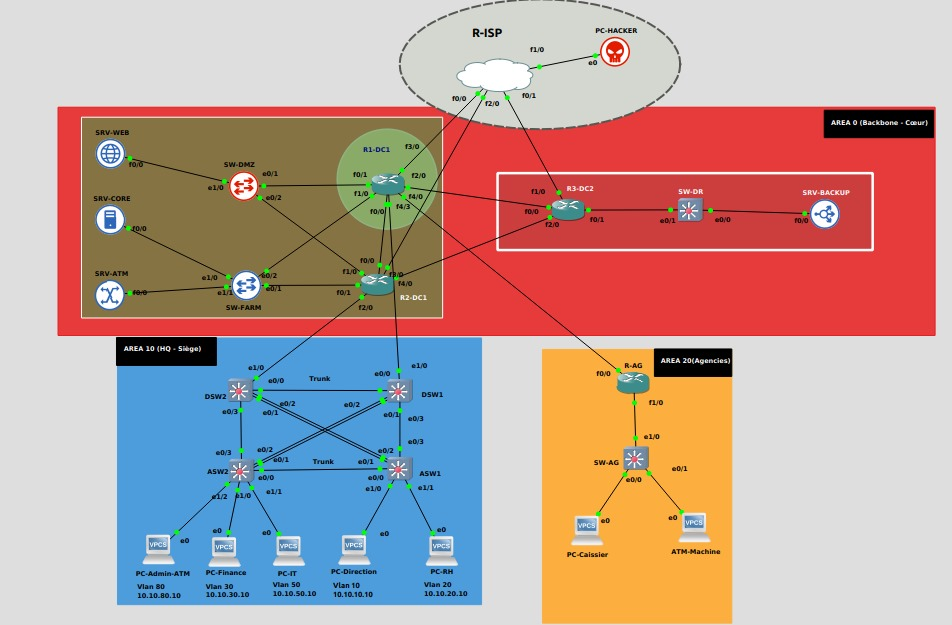
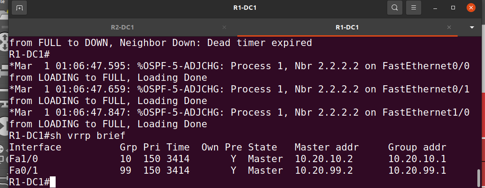
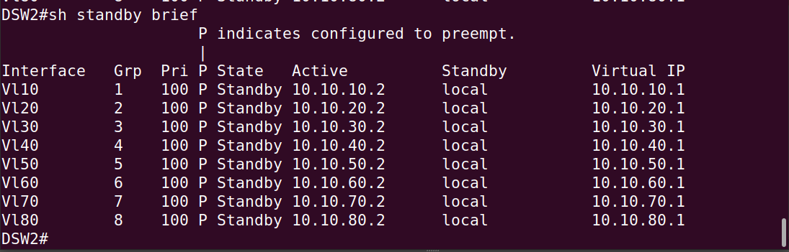
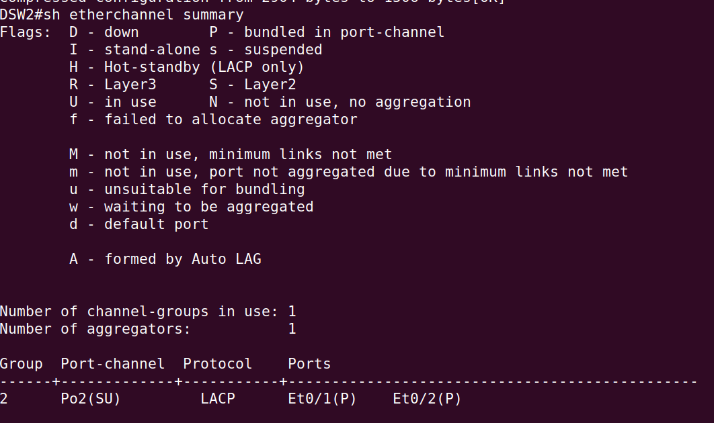
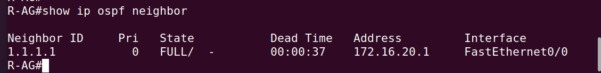
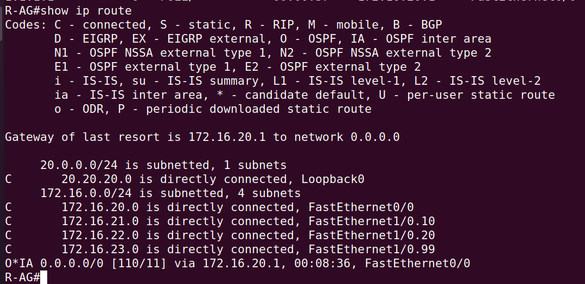

# NEXUS — High-Availability Banking Network Architecture

Design, deployment and validation in **GNS3** of a resilient multi-site network for a banking institution: primary data center, disaster-recovery site, headquarters and a remote branch, with **no single point of failure**.

> Academic project — Network Engineering, ENSA Fez (GSCSI), 2025–2026.

    

---

## Sites and OSPF areas

The network follows a **3-tier hierarchical model** (core / distribution / access) mapped onto three OSPF areas.

| Area | Site | Devices | Role |
|---|---|---|---|
| **Area 0 — Backbone** | Primary data center (DC1) + DR site (DC2) | R1-DC1 (1.1.1.1), R2-DC1 (2.2.2.2), R3-DC2 (3.3.3.3), SW-DMZ, SW-FARM | Mandatory transit area; maximum redundancy; DC1 ↔ DC2 dedicated "dark fiber" link for replication and disaster recovery |
| **Area 10 — Headquarters** | HQ | Layer-3 distribution DSW1 / DSW2, access ASW1 / ASW2, business PCs | Administrative services (HR, Finance, Admin, IT) segmented in VLANs |
| **Area 20 — Branch** | Remote agency | R-AG, SW-AG, teller PC, ATM | **Stub area** to limit routing traffic |
| Internet | Simulated ISP | R-ISP (200.200.200.1), external "hacker" PC | Primary / backup WAN links, external attack scenarios |

**Simulated endpoints:** web server in the DMZ, core banking database server, ATM transaction server and backup server in DC2; VPCS hosts for HR, Finance, Admin, teller, ATM and an external attacker.

## Technologies implemented

| Technology | Where | Purpose |
|---|---|---|
| **OSPF multi-area** | All routers and L3 switches | Fast convergence, hierarchical routing, summarization at HQ, stub branch |
| **VRRP** | R1-DC1 (master) / R2-DC1 (backup) | Transparent gateway failover in the data center |
| **HSRP** | DSW1 / DSW2 at HQ | One virtual gateway per VLAN (8 VLANs, VLAN 10 → 80) |
| **VLAN segmentation** | DMZ, server farm (SERVERS-CORE, SERVERS-ATM), HQ departments | Isolation of business domains and smaller broadcast domains |
| **802.1Q trunks & inter-VLAN routing** | Distribution layer | Multi-VLAN transport and routing between departments |
| **EtherChannel (LACP)** | Distribution ↔ core / access links | Link aggregation: more bandwidth and link redundancy |
| **ACLs** | Edge routers | Granular filtering to protect sensitive zones |
| **NAT** | R1-DC1 | Internet access |

## Validation

Every mechanism was tested and documented area by area.

**VRRP** — R1-DC1 is master on both data-center segments, R2-DC1 takes over on failure:

**HSRP** — DSW2 is standby for the 8 HQ VLANs, each with its virtual gateway:

**EtherChannel LACP** — port-channel bundled and in use:

**Branch (Area 20)** — OSPF adjacency in FULL state and inter-area default route learned from the backbone:

Other tests: end-to-end ICMP connectivity between sites, VLAN states on every switch, access ports, inter-distribution link, ARP tables and connectivity from the ATM.

## Possible evolutions

- eBGP peering between DC1, DC2 and the ISP for Internet multi-homing.
- Zero Trust micro-segmentation, NGFW and IDS/IPS; DHCP Snooping, Dynamic ARP Inspection, IP Source Guard.
- Centralized authentication (RADIUS / TACACS+) for administrator access.
- Monitoring of links, CPU and OSPF/HSRP events with Zabbix / Grafana.
- Automated disaster-recovery tests with Ansible or Python; SDN / SD-WAN migration.

## Skills demonstrated

Network architecture · high availability · OSPF multi-area & stub areas · VRRP · HSRP · VLAN · 802.1Q · inter-VLAN routing · EtherChannel/LACP · ACL · NAT · GNS3 · testing & documentation

---

**Author:** Khaoula Belhaj — final-year engineering student, Communicating Systems & Computer Security, ENSA Fez · [LinkedIn](https://linkedin.com/in/khaoula-belhaj-1999163a6)
